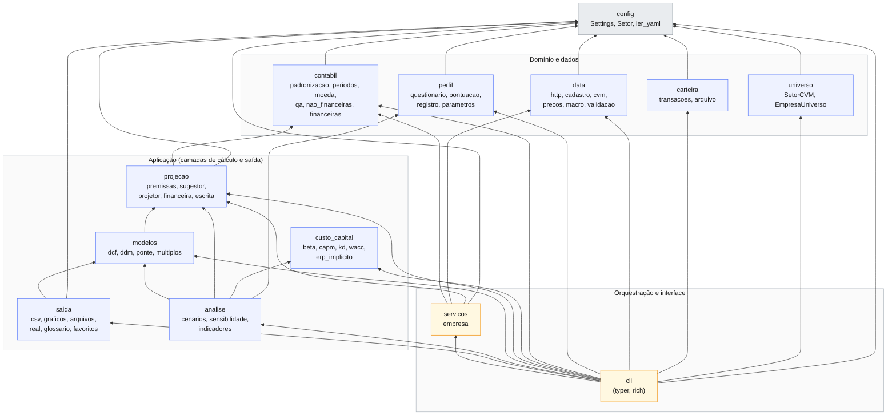
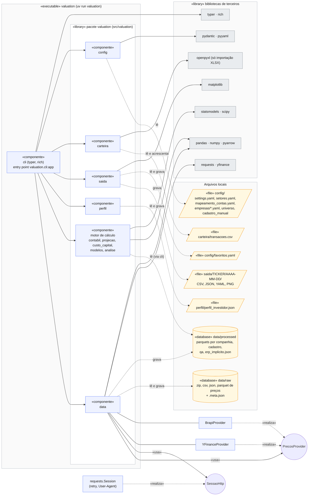
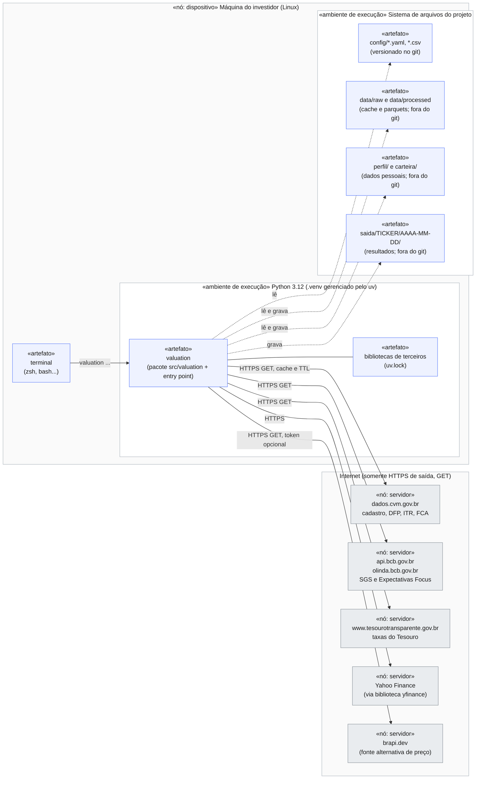

# Arquitetura — Lastro

Decisões estruturais do sistema em três visões, da lógica à física (Aula 10): **pacotes** (arquitetura lógica), **componentes** (arquitetura física do software) e **implantação** (ambiente de hardware). Índice em [`diagramas.md`](diagramas.md); as regras por camada estão em [`docs/regras/`](regras/README.md) e o detalhe de cada módulo no [`guia.md`](../guia.md).

> **Notação.** O Mermaid não tem diagramas de pacotes, componentes nem implantação; todos são `flowchart`. Pacote = caixa com o nome do pacote; componente = caixa marcada com `«componente»`; interface = círculo; nó de hardware = grupo `«nó»`; artefato = caixa dentro do nó. Seta cheia = dependência (`importa` ou `usa`); tracejada = realização, ou leitura/gravação de dados.

## 1. Arquitetura lógica — diagrama de pacotes

Estilo: **camadas em pipeline, com uma fachada de orquestração**. O grafo abaixo é o **real**, extraído dos `import` de `src/valuation/` (não o desejado): cada seta é "importa". Não há ciclos.

### Regras que o grafo materializa

| Regra | Como o grafo mostra |
|---|---|
| Camada superior nunca é importada por inferior | Todas as setas apontam para baixo; **só `cli` conhece todo mundo**, e `servicos` fica logo abaixo dela. |
| Trocar de fonte não toca nos modelos (regra 3 do `CLAUDE.md`) | `data` só depende de `config`; nenhum pacote de cálculo importa `data`. A `cli` entrega preços, macro e balanços por parâmetro. |
| O motor é de funções puras | `contabil`, `projecao`, `custo_capital`, `modelos` e `analise` não importam `data`: nada ali faz I/O de rede, e `data_base` e `agora` são parâmetros. |
| Perfil não altera fatos contábeis | `perfil` só depende de `config`; `analise` o consome para ponderar cenários, e `contabil`, `custo_capital` e `modelos` nem o conhecem. |
| Carteira fora do valuation (ADR 0020) | `carteira` só importa `config`; nenhuma camada de valuation a importa. |

Notas sobre desvios da imagem "em linha" do `CLAUDE.md` (seção 3, `data → contabil → projecao → …`):

- `data` e `contabil` são **independentes**: `contabil` lê `demonstracoes.parquet` pelo caminho (`padronizacao.ler_demonstracoes`), sem importar `data`.
- `custo_capital` **não depende de ninguém** (nem de `config`): recebe preços, taxas e métricas por parâmetro. Quem a consome é `analise` (Ke → WACC) e a `cli`.
- `saida` depende de `modelos` (para serializar `Avaliacao` e `AvaliacaoDDM`), não de `analise`.
- `universo` é só leitura do `config/universo_ibovespa.csv`; não consulta rede nem cadastro.

### Responsabilidades

| Pacote | Responsabilidade | Exceção própria |
|---|---|---|
| `config` | Carrega e valida `settings.yaml`, `setores.yaml` e caminhos; `extra="forbid"` | `ErroConfiguracao` |
| `data` | Único ponto de contato com o mundo externo: download com cache, CVM, cadastro, preços, macro, validação cruzada | `ErroDownload`, `ErroCadastro`, `ErroDadosCVM`, `ErroDadosExternos` |
| `contabil` | Reapresentações, plano de contas padronizado, períodos (anual, YTD, LTM), moeda, QA, métricas | `ErroContabil` |
| `perfil` | Questionário, pontuação, vetos, JSON com validade, parâmetros por perfil | `ErroPerfil` |
| `projecao` | Schema das premissas, sugestor, resolução por cenário, projeção ano a ano (FCFF e DDM) | `ErroProjecao` |
| `custo_capital` | Beta, Ke (CAPM), Kd, WACC, ERP implícito | `ErroCustoCapital` |
| `modelos` | DCF, ponte EV → equity, DDM com lucro residual, múltiplos | `ErroModelo` |
| `analise` | Cenários ponderados pelo perfil, taxas implícitas, matrizes de sensibilidade, indicadores por ativo | (usa `ErroModelo`) |
| `saida` | CSV, `meta.json`, valores reais, gráficos, glossário, favoritos | — |
| `carteira` | Transações da carteira pessoal: validação e importação CSV/XLSX | `ErroCarteira` |
| `universo` | Setores da CVM e empresas do Ibovespa por setor | — |
| `servicos` | Orquestração sem apresentação, comum à CLI e à GUI (ADR 0022); avisos no retorno | exceções de domínio das camadas abaixo |
| `cli` | Comandos `typer`, orquestração, tabelas `rich`, códigos de saída | captura todas as anteriores |

## 2. Arquitetura física — diagrama de componentes

Componentes são as peças físicas e substituíveis; interfaces são os pontos de troca. O sistema é **um só executável** (`valuation`) que usa bibliotecas e lê e grava arquivos locais: não há servidor próprio, banco de dados nem serviço.

### Interfaces

| Interface | Quem a oferece | Quem a usa | Para que serve |
|---|---|---|---|
| `PrecosProvider` (Protocol) | `YFinanceProvider` (principal), `BrapiProvider` (alternativa) | `precos.preco_validado`; a `cli` também o usa para entregar o câmbio alternativo a `macro`, por parâmetro | Trocar ou acrescentar fonte de preço sem tocar nos modelos |
| `SessaoHttp` (Protocol) | `requests.Session` (`criar_sessao`) e `SessaoFalsa` (testes) | `http.baixar`, `BrapiProvider`, `macro` | Testar tudo **sem rede** |
| Linha de comando `valuation` | `cli` | O investidor | Única interface com o usuário (sem GUI nem servidor) |

### Notas

- **Dependências de terceiros** conforme `pyproject.toml` (Python 3.11 a 3.13, fixado em 3.12 por `.python-version`; gerenciador `uv`). `python-bcb` está declarada, mas a SGS e a Focus são consultadas por REST direto (`data/macro.py`). `yfinance` é importada **dentro** da função (`_baixar`); `openpyxl`, só na importação de XLSX.
- **Substituibilidade**: os parquets de `data/processed/` são derivados e podem ser apagados (`atualizar --forcar` os recria); `data/raw/` é cache. O que **não** se recria sozinho: `perfil/perfil_investidor.json` (refazer o questionário), `config/` (versionado) e `carteira/transacoes.csv` (histórico pessoal, fora do git).
- **Sem segredos**: nenhuma chave é necessária. `BRAPI_TOKEN` (variável de ambiente, opcional) amplia só a fonte alternativa de preço.
- Pastas `data/`, `saida/`, `perfil/` e `carteira/` ficam no `.gitignore`.

## 3. Ambiente de hardware — diagrama de implantação

Uso **pessoal e local**: um único nó, a máquina Linux do investidor, que faz requisições HTTPS de saída para fontes públicas e gratuitas. Nada é exposto, e nenhum sistema externo chama o Lastro.

Efeitos da implantação sobre o projeto:

- **Disponibilidade das fontes**: toda chamada passa por `http.baixar` ou por um provedor, com cache, retry e *fallback* para a cópia vencida; sem rede, o que está no TTL continua funcionando. A validação cruzada de preço e macro (ADR 0004) usa duas fontes independentes quando existem.
- **Frescor**: TTL padrão de 168 h para CVM e cadastro, e de 12 h para preços e macro (`settings.cache_ttl_horas`).
- **Privacidade**: o perfil e a carteira nunca saem da máquina, e nenhum dado pessoal é enviado às fontes (só tickers e datas nas requisições).
- **Reprodutibilidade**: o `meta.json` de cada execução guarda commit do código, perfil, moeda e sha256 e data de cada fonte da CVM, então a rodada pode ser reconstruída a partir de `data/raw/` e `premissas_usadas.yaml`.

## 4. Arquitetura e casos de uso

Os [casos de uso](diagrama_casos_de_uso.md) dizem **o que** o sistema faz; esta arquitetura diz **com que forma**. Os requisitos não funcionais que mais moldaram a estrutura:

| Requisito | Decisão de arquitetura |
|---|---|
| Fontes gratuitas e instáveis | Adaptadores em `data/` com `PrecosProvider`, cache em disco, `.meta.json`, retry e validação cruzada |
| Resultado reproduzível e testável | Motor de funções puras sobre dataclasses `frozen`; `data_base` e `agora` por parâmetro; sessão HTTP injetável |
| Uma empresa por execução, base para todas | `rodar` orquestra uma empresa; `rodar-setor` e `favoritos atualizar` só repetem o `rodar` |
| Dois tipos de empresa (não financeira e financeira) | Mesmo esqueleto (contábil → projeção → modelo → cenários), com `dcf` ou `ddm` plugado por `tipo_modelo` |
| Perfil não muda fatos | `perfil` isolado, consumido só em `analise` (pesos e margem) e na escolha do horizonte |
| Uso pessoal, local, sem segredos | Um executável, arquivos locais, nenhuma chave obrigatória |
