# Diagrama de Atividades — Pipeline de Valuation

Este documento descreve o fluxo de atividades (UML Activity Diagram) de ponta a ponta do projeto **Lastro**, mapeando o ciclo de vida completo desde a interação via CLI e ingestão de dados até os cálculos contábeis, modelagem financeira (DCF e DDM), análise de sensibilidade e geração dos artefatos de saída.

> **Importante:** Este documento **não substitui** o [`guia.md`](../guia.md); eles se **complementam**. O diagrama de atividades oferece a visão dinâmica do fluxo do processo, decisões e ciclo de vida do pipeline, enquanto o `guia.md` mapeia a estrutura dos módulos, contratos de funções, parâmetros, convenções e armadilhas do código. O agente e os desenvolvedores devem consultar ambos.

---

## 1. Diagrama de Atividades Completo

```mermaid
flowchart TD
    %% Nós Iniciais e Finais
    startNode((Início))
    endSuccess(((Fim: Avaliação Concluída)))
    endError(((Fim com Erro)))

    %% -------------------------------------------------------------
    %% RAIA 1: INTERFACE & CONFIGURAÇÕES
    %% -------------------------------------------------------------
    subgraph LANE_CLI ["1. Interface do Usuário, CLI & Configuração"]
        startNode --> cmdCheck{"Qual comando foi executado?"}
        
        cmdCheck -->|"valuation perfil"| actQuestionario["Aplicar Questionário de Perfil (10 perguntas com regras de veto)"]
        actQuestionario --> actGravarPerfil["Salvar perfil_investidor.json (Conservador / Moderado / Arrojado)"]
        actGravarPerfil --> endSuccess

        cmdCheck -->|"valuation atualizar"| actTriggerAtualizar["Iniciar Ingestão de Dados Externos"]
        
        cmdCheck -->|"valuation rodar TICKER"| checkPerfil{"Existe Perfil Válido? (< 12 meses)"}
        checkPerfil -- "Não (e sem --perfil)" --> errSemPerfil["Erro: Perfil obrigatório para execução"]
        errSemPerfil --> endError
        
        checkPerfil -- "Sim" --> loadConfig["Carregar settings.yaml e config/empresas/{TICKER}.yaml"]
    end

    %% -------------------------------------------------------------
    %% RAIA 2: INGESTÃO & VALIDAÇÃO DE DADOS
    %% -------------------------------------------------------------
    subgraph LANE_DATA ["2. Coleta de Dados & Validação Cruzada"]
        actTriggerAtualizar --> checkCache{"Verificar Cache Local (TTL e SHA256)"}
        loadConfig --> checkLocalData{"Demonstrações já baixadas localmente?"}
        checkLocalData -- "Não" --> checkCache
        
        checkCache -- "Inválido / --forcar" --> forkDownload[["Fork: Disparar Downloads"]]
        checkCache -- "Válido no TTL" --> readCache["Ler Parquets Locais em data/raw/ e data/processed/"]
        
        forkDownload --> fetchCVM["CVM: DFP (10 anos), ITR (2 anos) e Composição de Capital"]
        forkDownload --> fetchMercado["Mercado: Cotações Históricas (yfinance e brapi)"]
        forkDownload --> fetchMacro["Macro: Selic, IPCA 12m, Dólar, Rf NTN-F/NTN-B (BCB / Tesouro)"]
        
        fetchMercado --> crossValMercado["Validação Cruzada de Cotações (Tolerância relativa máx 2%)"]
        fetchMacro --> crossValMacro["Validação Cruzada de Indicadores Macro (SGS vs Focus vs Tesouro)"]
        
        fetchCVM --> joinIngest[["Join: Consolidar Arquivos Brutos"]]
        crossValMercado --> joinIngest
        crossValMacro --> joinIngest
        
        joinIngest --> saveRaw["Gravar Parquets de Dados Processados e Metadados (.meta.json)"]
        saveRaw --> readCache
    end

    %% -------------------------------------------------------------
    %% RAIA 3: PADRONIZAÇÃO CONTÁBIL & QA
    %% -------------------------------------------------------------
    subgraph LANE_CONTABIL ["3. Padronização Contábil & Auditoria (QA)"]
        readCache --> selReapresentacoes["Filtrar Reapresentações (Versão mais recente prevalece por período)"]
        checkLocalData -- "Sim" --> selReapresentacoes

        selReapresentacoes --> mapContas["Mapear Plano de Contas Padronizado (mapeamento_contas.yaml)"]
        mapContas --> genVisoes["Gerar Visões Temporais (Anual, Acumulado no Ano, Trimestral, LTM, Saldos)"]
        genVisoes --> calcMetricasHist["Calcular Métricas Históricas (EBITDA, NOPAT, Capex, NWC, ROIC ou ROE/Payout)"]
        
        calcMetricasHist --> runQA["Executar Controles de Qualidade (QA: Balanço fecha, DRE, Saltos, D&A)"]
        runQA --> checkQA{"Passou nos Testes de QA?"}
        
        checkQA -- "Erros Críticos de Conciliação" --> abortQA["Interromper Execução (Exit 1) e registrar em qa_{TICKER}.json"]
        abortQA --> endError
        
        checkQA -- "Sucesso ou Apenas Avisos" --> checkTipoModelo{"Qual o Modelo da Empresa?"}
    end

    %% -------------------------------------------------------------
    %% RAIA 4: CUSTO DE CAPITAL & PROJEÇÃO
    %% -------------------------------------------------------------
    subgraph LANE_ENGINE ["4. Custo de Capital & Projeção Financeira"]
        checkTipoModelo -->|"Holding / Não Suportada"| abortHolding["Interromper: Requer SOTP/NAV (Fora do escopo v1)"]
        abortHolding --> endError

        %% Ramo: Não-Financeiras (Industrial / Comercial / Commodity)
        checkTipoModelo -->|"Não Financeira"| branchNaoFin["Definir Parâmetros DCF"]
        branchNaoFin --> calcBeta["Calcular Beta da Ação (Regressão semanal 5a vs Ibovespa + Ajuste Blume ou Pares)"]
        calcBeta --> calcKe["Calcular Custo do Capital Próprio - Ke (CAPM BRL Direto ou USD CRP)"]
        calcKe --> calcKd["Calcular Custo da Dívida - Kd (Despesas Financeiras / Dívida Bruta Média)"]
        calcKd --> calcWACC["Calcular WACC ponderando D/(D+E) atual ou alvo setorial"]
        
        calcWACC --> checkWaccG{"Consistência: WACC > g nominal terminal?"}
        checkWaccG -- "Não (WACC <= g)" --> abortWacc["Interromper: Crescimento perpétuo supera taxa de desconto"]
        abortWacc --> endError
        
        checkWaccG -- "Sim" --> projNaoFin["Projetar Demonstrações (Receita, Margem EBITDA, Reversão à Mediana, NOPAT, Capex, NWC e FCFF)"]

        %% Ramo: Financeiras (Bancos / Seguradoras)
        checkTipoModelo -->|"Financeira"| branchFin["Definir Parâmetros DDM"]
        branchFin --> calcKeFin["Calcular Ke Próprio para Financeiras (sem alavancagem WACC nem Kd)"]
        
        calcKeFin --> checkKeG{"Consistência: Ke > g?"}
        checkKeG -- "Não (Ke <= g)" --> abortKe["Interromper: Crescimento perpétuo supera custo do capital próprio"]
        abortKe --> endError
        
        checkKeG -- "Sim" --> projFin["Projetar Trajetória: ROE em rampa até LP, Payout até 1 - g/ROE, Evolução do PL e Dividendos"]
    end

    %% -------------------------------------------------------------
    %% RAIA 5: MODELAGEM, COMPARÁVEIS & CENÁRIOS
    %% -------------------------------------------------------------
    subgraph LANE_VALUATION ["5. Modelos de Valuation, Cenários & Sensibilidade"]
        %% Avaliação DCF
        projNaoFin --> dcfEngine["Descontar FCFF a Valor Presente (Convenção de Meio Período)"]
        dcfEngine --> calcVT["Calcular Valor Terminal (Perpetuidade via Gordon / Value Driver RONIC)"]
        calcVT --> ponteEV["Aplicar Ponte de Valor (EV -> Equity: + Caixa - Dívida Bruta - Arrendamento IFRS 16 - Minoritários)"]
        ponteEV --> valAcaoDCF["Calcular Valor Intrínseco por Ação (DCF)"]

        %% Avaliação DDM
        projFin --> ddmEngine["Descontar Fluxo de Dividendos a Valor Presente"]
        ddmEngine --> calcVTFin["Calcular Valor Terminal dos Dividendos + Validação Cruzada por Lucro Residual"]
        calcVTFin --> valAcaoDDM["Calcular Valor Intrínseco por Ação (DDM)"]

        valAcaoDCF --> joinModels[["Join: Unificar Resultado do Modelo Base"]]
        valAcaoDDM --> joinModels

        joinModels --> peersEval["Avaliar Múltiplos dos Pares do Setor (P/L, EV/EBITDA, P/VP winsorizados P10/P90)"]
        peersEval --> cenariosAnalise["Gerar Projeções em 3 Cenários (Base, Otimista [+1 DP] e Pessimista [-1 DP])"]
        cenariosAnalise --> perfilWeight["Ponderar Cenários conforme Pesos do Perfil do Investidor"]
        perfilWeight --> calcTeto["Aplicar Margem de Segurança do Perfil -> Preço Teto de Compra"]
        calcTeto --> sensAnalise["Gerar Matrizes de Sensibilidade (WACC x g, Margem x Crescimento ou ROE x Ke)"]
        sensAnalise --> implRates["Calcular Retornos Implícitos na Cotação Atual (Ke implícito vs Taxa Hurdle)"]
    end

    %% -------------------------------------------------------------
    %% RAIA 6: SAÍDA & DECISÃO
    %% -------------------------------------------------------------
    subgraph LANE_OUTPUT ["6. Exportação de Artefatos & Relatório"]
        implRates --> exportCSVs["Gravar Artefatos CSV em saida/{TICKER}/{data_base}/ (resumo, wacc, projecao, ponte, sensibilidade)"]
        exportCSVs --> printTerminal["Exibir Relatório Educacional no Terminal (Preço Atual vs Preço Justo Ponderado vs Preço Teto)"]
        printTerminal --> endSuccess
    end
```

---

## 2. Detalhamento por Raia (Swimlanes)

### Raia 1: Interface do Usuário, CLI & Configuração
- **Comandos CLI (`src/valuation/cli.py`):**
  - `valuation perfil`: Executa questionário com 10 perguntas e regras de veto para classificar o perfil em *Conservador*, *Moderado* ou *Arrojado* (`perfil/questionario.py`), gerando `perfil/perfil_investidor.json` válido por 12 meses.
  - `valuation atualizar`: Dispara o download e atualização da base contábil e de mercado.
  - `valuation rodar TICKER`: Executa a avaliação completa. Requer perfil cadastrado dentro da validade ou passagem explícita de `--perfil`.
- **Configuração:** Leitura estrita de `config/settings.yaml` (tipado via Pydantic com `extra="forbid"`) e premissas específicas da empresa em `config/empresas/{TICKER}.yaml`.

### Raia 2: Coleta de Dados & Validação Cruzada
- **Isolamento e Cache (`src/valuation/data/`):**
  - Ponto único de download em `data/http.py` com TTL configurável, revalidação condicional (HTTP 304) e fail-soft com fallback para cache expirado em caso de indisponibilidade externa.
  - Ingestão CVM: DFPs dos últimos 10 anos, ITRs dos últimos 2 anos e composição de capital (`data/cvm.py`).
- **Validação Cruzada (`data/validacao.py`, ADR 0004):**
  - Cotações obtidas via `yfinance` e validadas contra `brapi`.
  - Indicadores macroeconômicos (SGS/BCB, Focus e Tesouro Direto) validados contra fontes secundárias com limites rígidos de tolerância relativa/absoluta.

### Raia 3: Padronização Contábil & Auditoria (QA)
- **Reapresentações Contábeis (`src/valuation/contabil/padronizacao.py`):**
  - Desempate determinístico: a versão mais recente entregue à CVM tem precedência por período contábil e família.
- **Plano de Contas:** Normalização baseada em `config/mapeamento_contas.yaml` gerando visões Anual, Trimestral, Acumulada no Ano, LTM e Saldos patrimoniais.
- **Controle de Qualidade (`src/valuation/contabil/qa.py`):**
  - Validações matemáticas: Balanço fecha ($Ativo = Passivo + PL$), identidades fundamentais da DRE, consistência de D&A e identificação de descontinuidades/saltos atípicos.
  - *Fail-Fast:* Inconsistências críticas encerram o processo com código `1`.

### Raia 4: Custo de Capital & Projeção Financeira
- **Tratamento de Empresas Não-Financeiras:**
  - Beta ($\beta$) via regressão linear semanal de 5 anos (260 semanas) contra o Ibovespa, ajustado por Blume ($0{,}67 \beta + 0{,}33$) ou via comparáveis desalavancados (Hamada).
  - Custo do Capital Próprio ($K_e$) via CAPM (`brl_direto` ou `usd_crp`).
  - Custo da Dívida ($K_d$) histórico via despesas financeiras / dívida bruta média (com piso e teto em relação à $R_f$).
  - $WACC$ ponderando $D/(D+E)$ atual de mercado ou estrutura-alvo.
  - Projeção de demonstrações: Receita, margens EBITDA (com reversão à mediana histórica), depreciação, capex, capital de giro e Fluxo de Caixa Livre da Firma ($FCFF$).
- **Tratamento de Empresas Financeiras (Bancos e Seguradoras):**
  - Não utilizam WACC nem conceito tradicional de capital de giro / endividamento operacional.
  - Utilização de $K_e$ próprio.
  - Projeção de evolução do Patrimônio Líquido, convergência do ROE até a taxa de longo prazo e payout sustentável $1 - (g / ROE)$.

### Raia 5: Modelos de Valuation, Cenários & Sensibilidade
- **Valuation Não-Financeiro:**
  - DCF descontado pela convenção de meio período ($t - 0{,}5$).
  - Valor Terminal ($VT$) calculado via modelo de perpetuidade com reinvestimento explícito baseado em RONIC.
  - Ponte de Valor: $EV \to Equity = EV + \text{Caixa} - \text{Dívida Bruta} - \text{Arrendamento (IFRS 16)} - \text{Minoritários} - \text{Provisões/Contingências}$.
- **Valuation Financeiro:**
  - Desconto de Dividendos ($DDM$) e validação cruzada por Lucro Residual (Residual Income).
- **Múltiplos e Comparáveis Setoriais (`src/valuation/modelos/multiplos.py`):**
  - Múltiplos dos pares do setor (`config/setores.yaml`) com winsorização entre percentis 10% e 90% (P/L, EV/EBITDA, P/VP, etc.).
- **Análise Estocástica e Perfil do Investidor:**
  - Geração de 3 cenários: Base, Otimista (+1 DP) e Pessimista (-1 DP).
  - Ponderação dos cenários pelas probabilidades subjetivas do perfil do investidor.
  - Dedução da Margem de Segurança específica do perfil para determinação do **Preço Teto de Compra**.
  - Matrizes de sensibilidade bidimensionais ($WACC \times g$, $\text{Margem} \times \text{Crescimento}$, $ROE \times K_e$).
  - Cálculo de retornos implícitos no preço atual de mercado ($K_e$ implícito vs Hurdle Rate).

### Raia 6: Saída, Relatórios & Decisão
- **Artefatos Gravados em disco (`saida/{TICKER}/{data_base}/`):**
  - `resumo.csv`: Resumo executivo de múltiplos, premissas, valor intrínseco e preço teto.
  - `wacc.csv`: Abertura completa dos componentes de taxa de desconto e capital.
  - `projecao_{cenario}.csv`: Demonstrações projetadas ano a ano até a perpetuidade.
  - `ponte_ev_equity.csv`: Conciliação minuciosa dos itens da ponte patrimonial.
  - `sensibilidade_*.csv`: Tabelas completas de estresse de parâmetros.
- **Terminal:** Apresentação formatada das recomendações e métricas de valuation com destaques visuais.

---

## 3. Travas de Segurança e Fail-Fast (Critérios de Interrupção)

| Ponto de Controle | Condição de Falha | Ação do Sistema |
|---|---|---|
| **Perfil do Investidor** | `perfil_investidor.json` inexistente ou com mais de 12 meses | Bloqueia comando `rodar` a menos que `--perfil` seja fornecido explicitamente |
| **Integridade Contábil (QA)** | Diferença de balanço, identidade DRE rompida ou saltos inexplicados | Encerra com código `1` e grava diagnóstico em `data/processed/qa/` |
| **Taxa de Desconto vs Perpetuidade** | $WACC \le g_{\text{terminal}}$ ou $K_e \le g_{\text{terminal}}$ | Encerra com código `1` por inconsistência matemática do modelo de Gordon |
| **Tipo de Empresa** | Holding financeira pura ou estrutura não suportada na v1 | Bloqueia execução e alerta necessidade de avaliação por SOTP/NAV |
| **Validação Cruzada de APIs** | Divergência de preço $> 2\%$ ou câmbio $> 1{,}5\%$ | Alerta exibido no terminal e registrado nos metadados |

