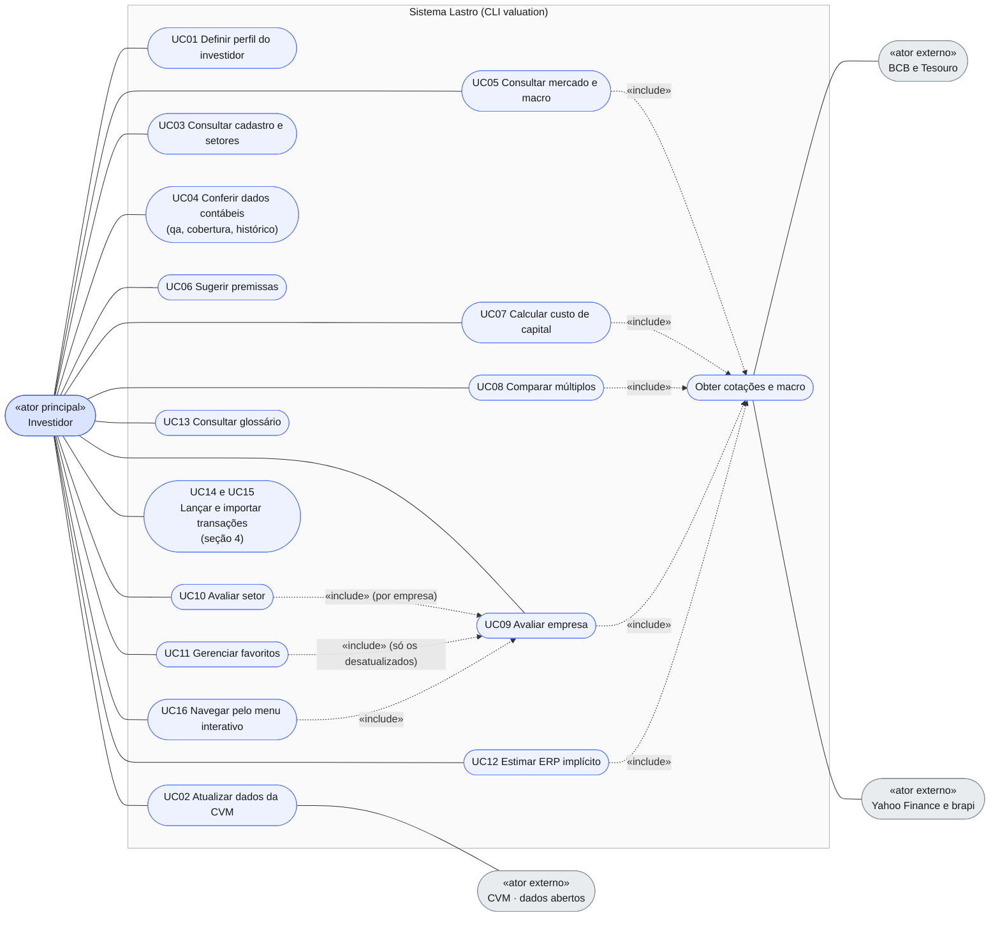
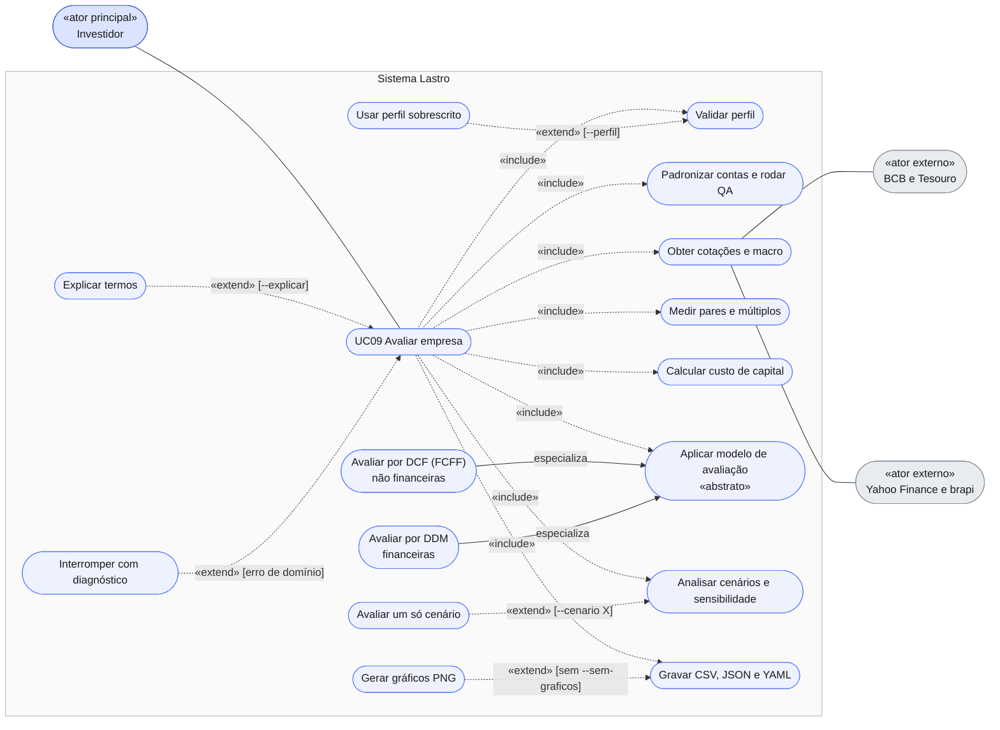
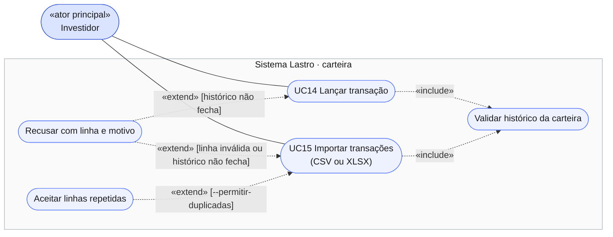

# Diagrama de Casos de Uso — Lastro

Mostra a **visão externa** do sistema: quem o usa, o que pede e quais sistemas externos ele consulta. O *como* está nos outros diagramas (índice em [`diagramas.md`](diagramas.md)): fluxo em [atividades](diagrama_atividades.md), ordem das chamadas em [sequência](diagrama_sequencia.md) e [interação](diagrama_interacao.md). Contratos e parâmetros ficam no [`guia.md`](../guia.md).

O sistema é uma **CLI** (`valuation`, em [`cli.py`](../src/valuation/cli.py)) de uso pessoal. Cada comando é um caso de uso; a tabela da seção 5 liga cada um ao seu comando.

> **Notação.** O Mermaid não tem diagrama de casos de uso; ele é desenhado como `flowchart`: elipse = caso de uso, retângulo arredondado = ator, linha cheia = associação, tracejada com `«include»`/`«extend»` = relações entre casos de uso (a seta sai de quem inclui e chega em quem é incluído; no `«extend»` sai da extensão e chega no caso-base), seta de **especialização** = generalização.

## 1. Atores

| Ator | Tipo | Papel |
|---|---|---|
| Investidor | principal | Única pessoa que usa o sistema (uso pessoal, local, em Linux). Roda os comandos, responde ao questionário e lê o resultado. |
| CVM (dados abertos) | secundário, sistema externo | Fornece cadastro, DFP, ITR, FCA e composição do capital (`dados.cvm.gov.br`). |
| BCB e Tesouro Transparente | secundário, sistema externo | Fornece SGS, Expectativas Focus (Olinda) e taxas do Tesouro (Selic, IPCA, dólar, Rf). |
| Yahoo Finance e brapi | secundário, sistema externo | Fornece cotações, Ibovespa e dólar. brapi é a segunda fonte da validação cruzada. |

Os sistemas externos **não iniciam** nada: respondem a requisições do sistema, sempre por meio de um adaptador em `data/` com cache.

## 2. Visão geral

Leitura:

- `UC10 Avaliar setor`, `UC11 Gerenciar favoritos` (subcomando `atualizar`) e `UC16` reaproveitam o `UC09` em vez de reimplementá-lo. Em UC10 e UC11, uma falha numa empresa **não** interrompe as demais.
- `Obter cotações e macro` nunca roda sozinho: é o trecho comum que `mercado`, `wacc`, `comparar`, `rodar` e `erp` compartilham (`cli._mercado`). Só ele fala com BCB, Tesouro, Yahoo e brapi.
- `UC02` é o **único** que baixa DFP, ITR e composição do capital. Os demais leem os parquets de `data/processed/` e, sem eles, pedem para rodar `atualizar`. O cadastro (CVM e FCA) é a exceção: vários comandos o carregam por `_carregar_cadastro`, sempre com cache e TTL.

## 3. Detalhe de UC09 — Avaliar empresa (`valuation rodar TICKER`)

Escolha do modelo: `tipo_modelo = nao_financeira` usa o DCF do FCFF e `financeira` usa o DDM com lucro residual (ramo `_rodar_financeira`). `holding` e `nao_suportada` não têm modelo na v1 e caem em *Interromper com diagnóstico*.

`Interromper com diagnóstico` é a variante excepcional (como "Item Preso" da aula): perfil ausente ou vencido sem `--perfil`; QA com erro (grava `qa_TICKER.json`); holding ou tipo não suportado; WACC ≤ g (ou Ke ≤ g nas financeiras); preço ou composição de capital indisponíveis. Em todos, mensagem em PT-BR e saída 1.

## 4. Carteira pessoal (ADR 0020, Etapa C1)

Camada à parte do valuation: não lê CVM nem cotações. As Etapas C2 a C6 (posição, preço médio, proventos, alocação) ainda não existem; quando entrarem, ganham casos de uso próprios aqui.

## 5. Catálogo: caso de uso, comando e módulos

| Caso de uso | Comando | Módulos principais |
|---|---|---|
| UC01 Definir perfil | `perfil [--mostrar\|--refazer]` | `perfil/` |
| UC02 Atualizar dados | `atualizar [--tickers\|--tudo] [--com-pares] [--forcar]` | `data/{http,cadastro,cvm}` |
| UC03 Consultar cadastro e setores | `cadastro buscar`, `setores [SETOR]` | `data/cadastro`, `universo` |
| UC04 Conferir dados contábeis | `qa`, `cobertura`, `historico` | `contabil/` |
| UC05 Consultar mercado e macro | `mercado` | `data/{precos,macro,validacao}` |
| UC06 Sugerir premissas | `premissas sugerir [--escrever]` | `projecao/{sugestor,escrita}` |
| UC07 Calcular custo de capital | `wacc` | `custo_capital/` |
| UC08 Comparar múltiplos | `comparar` | `modelos/multiplos` |
| UC09 Avaliar empresa | `rodar` | todas as camadas, orquestradas por `cli.py` |
| UC10 Avaliar setor | `rodar-setor` | `universo`, UC09 |
| UC11 Gerenciar favoritos | `favoritos [adicionar\|remover\|atualizar]` | `saida/favoritos`, UC09 |
| UC12 Estimar ERP implícito | `erp` | `custo_capital/erp_implicito` |
| UC13 Consultar glossário | `glossario [TERMO]` | `saida/glossario` |
| UC14 Lançar transação | `carteira lancar` | `carteira/` |
| UC15 Importar transações | `carteira importar` | `carteira/` |
| UC16 Navegar pelo menu | `valuation` (sem comando) | `cli._menu_interativo`, `universo` |

## 6. Especificação dos casos de uso principais

Fluxo principal e variantes, no formato da aula (fluxo principal de eventos × fluxo excepcional).

### UC01 — Definir perfil do investidor

- **Pré-condição:** nenhuma. **Pós-condição:** `perfil/perfil_investidor.json` válido por 12 meses.
- **Fluxo principal:** (1) o sistema não acha perfil gravado, ou ele venceu; (2) apresenta as 10 perguntas; (3) o investidor responde com o número da alternativa; (4) o sistema soma os pontos (10 a 50), aplica os vetos e classifica; (5) grava o JSON e mostra o perfil com margem de segurança, pesos dos cenários, horizonte e hurdle.
- **Variantes:** perfil ainda válido ⇒ só o mostra (`--refazer` responde de novo; `--mostrar` nunca pergunta). Resposta inválida ⇒ pergunta de novo.
- **Excepcional:** `--mostrar` sem perfil gravado ou JSON adulterado ⇒ erro, saída 1. `--mostrar` junto de `--refazer` ⇒ erro.
- **Regra:** horizonte menor que 2 anos ou "não aceito perdas" ⇒ conservador, qualquer que seja a soma.

### UC02 — Atualizar dados da CVM

- **Pré-condição:** acesso à rede (ou cache). **Pós-condição:** `demonstracoes.parquet` e `composicao_capital.parquet` por companhia em `data/processed/cvm/{cd_cvm}/`.
- **Fluxo principal:** (1) o investidor informa `--tickers` ou `--tudo`; (2) o sistema carrega o cadastro (cache por TTL); (3) resolve ticker → CNPJ → `CD_CVM`; (4) baixa DFP (10 anos), ITR (2 anos) e composição de capital pela `http.baixar`, que respeita TTL e revalida com 304; (5) corrige a escala das ações e grava os parquets; (6) mostra a tabela por companhia.
- **Variantes:** `--com-pares` inclui os pares do YAML da empresa; `--forcar` ignora o cache.
- **Excepcional:** nenhum ou os dois de `--tickers`/`--tudo` ⇒ erro. Ticker fora do cadastro ⇒ `ErroCadastro`. Rede fora do ar com cópia antiga ⇒ usa a cópia, com aviso (sem `--forcar`). 404 só é tolerado no ano mais recente. Holding ou tipo não suportado ⇒ só avisa e baixa.

### UC09 — Avaliar empresa

- **Pré-condição:** dados baixados (UC02) e perfil válido, ou `--perfil`. **Pós-condição:** pasta `saida/{TICKER}/{data-base}/` completa e reprodutível.
- **Fluxo principal (não financeira):** (1) valida o perfil e carrega `settings.yaml` e o YAML da empresa; (2) padroniza as contas e roda o QA; (3) sugere e resolve as premissas; (4) obtém cotações e macro, com validação cruzada; (5) mede os pares; (6) calcula beta, Ke, Kd e WACC; (7) avalia os cenários pessimista, base e otimista pelo DCF e pela ponte EV → equity; (8) pondera pelos pesos do perfil e aplica a margem de segurança; (9) gera sensibilidade e o g implícito dos pares; (10) mostra as tabelas e grava CSV, JSON, YAML e PNG.
- **Variante financeira:** no passo 6 só há beta e Ke; o passo 7 usa o DDM com checagem por lucro residual.
- **Variantes de opção:** `--cenario X` avalia só X (peso 100%); `--sem-graficos` omite os PNG; `--explicar` acrescenta a legenda dos termos; `--forcar` ignora o cache de mercado.
- **Excepcional:** ver *Interromper com diagnóstico* (seção 3). Divergência de preço ou câmbio entre as fontes **não** interrompe: vira aviso. Par sem dados vira aviso; nenhum par ⇒ segue sem múltiplos.

### UC14 e UC15 — Lançar e importar transações

- **Pré-condição:** nenhuma (o arquivo `carteira/transacoes.csv` é criado no primeiro uso). **Pós-condição:** transações acrescentadas ao fim do arquivo; o que já estava nele não é reescrito.
- **Fluxo principal:** (1) o investidor informa a transação (UC14) ou um arquivo CSV/XLSX (UC15); (2) o sistema normaliza e valida cada linha por tipo; (3) valida o histórico inteiro (carteira gravada + novas), por data; (4) acrescenta tudo.
- **Excepcional:** qualquer linha inválida, venda acima da posição, evento sem posição ou data futura ⇒ **nada é gravado**, cada erro sai com o número da linha, saída 1. Linha idêntica a uma já gravada (reimportação) é recusada, salvo `--permitir-duplicadas`.
