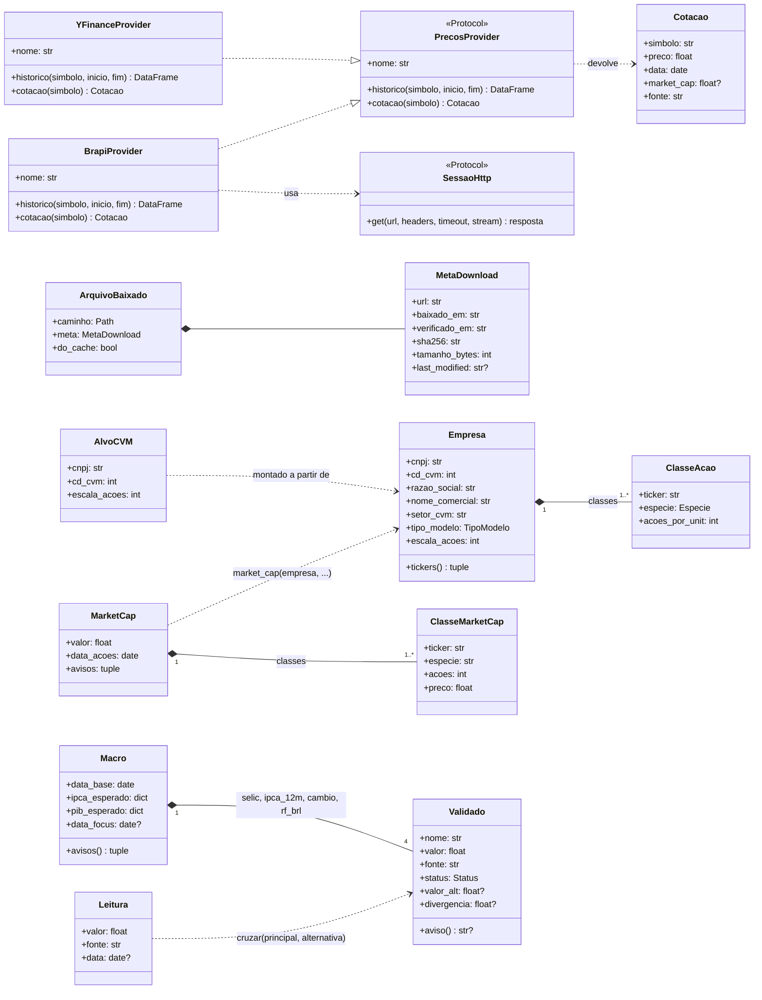
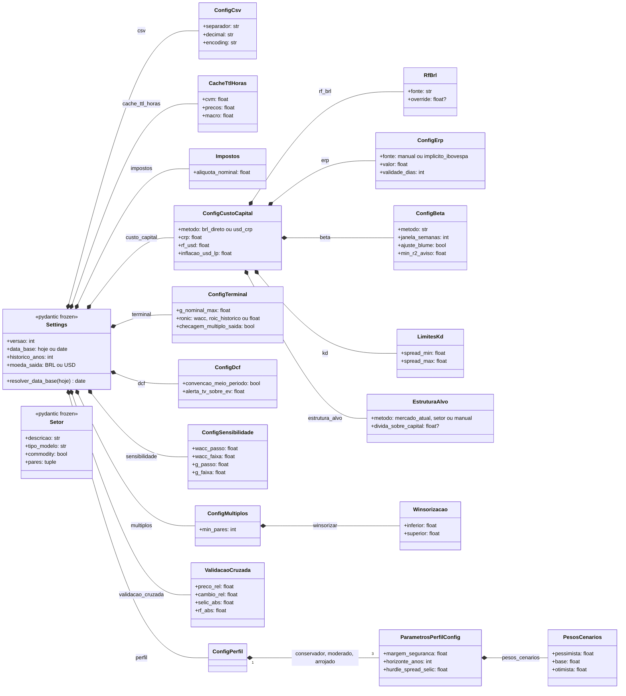
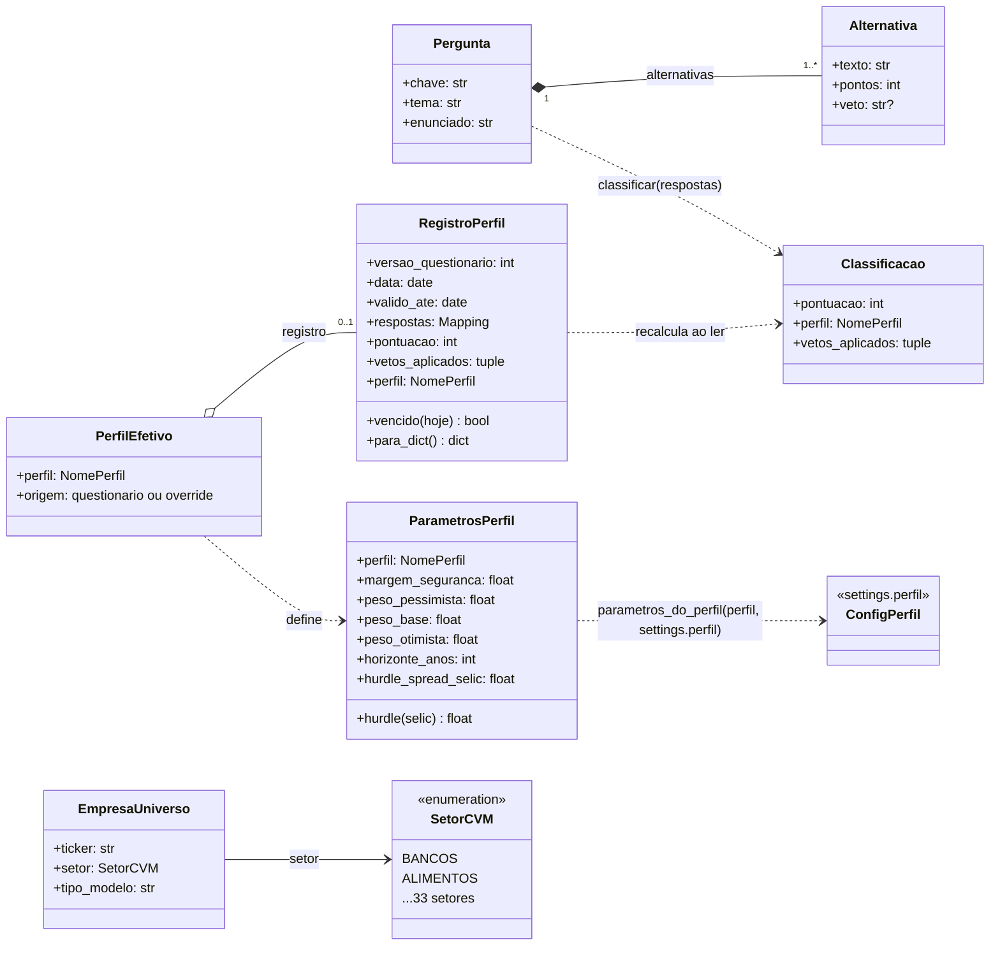
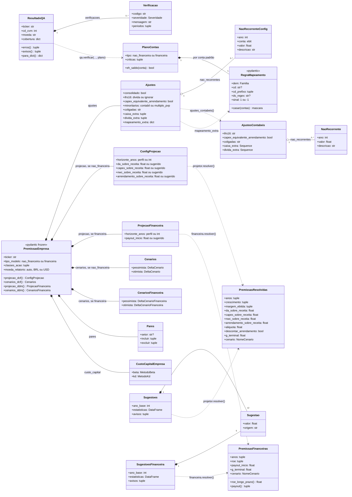
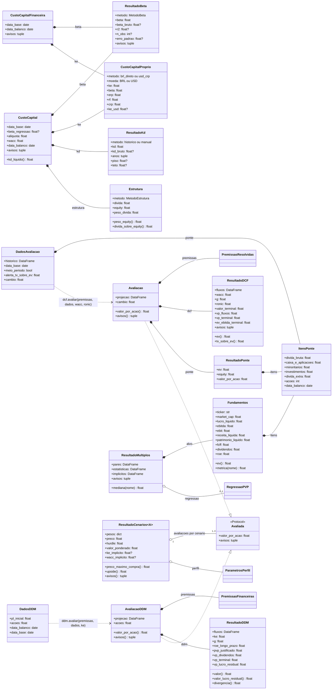
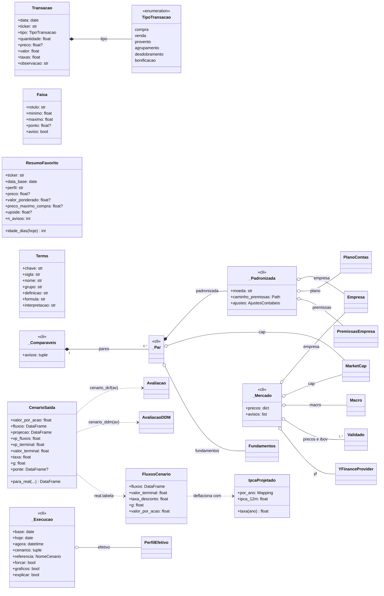
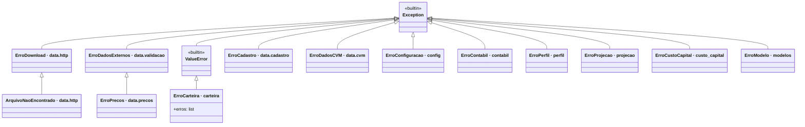

# Diagrama de Classes — Lastro

Estrutura estática do código: as classes, os atributos principais e como se relacionam. O comportamento está nos diagramas de [atividades](diagrama_atividades.md), [sequência](diagrama_sequencia.md), [interação](diagrama_interacao.md) e [estados](diagrama_estados.md); as instâncias em [objetos](diagrama_objetos.md). Índice em [`diagramas.md`](diagramas.md). Assinaturas e contratos completos ficam no [`guia.md`](../guia.md).

## Como ler

- **Estilo do código.** O motor de cálculo é de **funções puras** sobre **dataclasses `frozen`**. Por isso as classes têm quase só atributos e as operações (`projetar`, `descontar`, `avaliar`, `ponte`…) são funções de módulo, não métodos. Mostro como operação apenas o que é método de fato (`tickers`, `ev`, `hurdle`…).
- **Pydantic** (`extra="forbid"`, `frozen`) só na configuração: `Settings` e `PremissasEmpresa`.
- **`<<Protocol>>`** é tipagem estrutural do Python (sem herança explícita). A seta de realização tracejada (`..|>`) indica "satisfaz o contrato".
- **Composição** (`*--`): o todo cria e carrega as partes. **Agregação** (`o--`): referência a algo que existe por si. **Dependência** (`..>`): a função que produz ou consome o objeto (ex.: `cruzar` produz `Validado` a partir de duas `Leitura`).
- Cada diagrama mostra os **atributos principais**; a lista completa está no código. Uma classe sem atributos num diagrama é uma referência a outro diagrama.
- Valores `Literal` aparecem como o nome do tipo (`NomePerfil` = `conservador`, `moderado` ou `arrojado`; `NomeCenario` = `pessimista`, `base` ou `otimista`).

## 1. Dados externos e cadastro (`data/`)

- `Status` de `Validado`: `ok`, `divergente`, `sem_validacao` ou `manual`. Divergência **não interrompe**: vira aviso, e o valor usado é o da fonte principal (ADR 0004).
- `TipoModelo`: `nao_financeira`, `financeira`, `holding` ou `nao_suportada`. `Especie`: `ON`, `PN` ou `UNIT`.
- `PrecosProvider` e `SessaoHttp` são os **pontos de troca**: nova fonte de preço ou sessão falsa nos testes entram sem tocar nos modelos (regra 3 do `CLAUDE.md`).

## 2. Configuração (`config.py`)

`Setor` é lido de `config/setores.yaml` por `carregar_setores` (não faz parte de `Settings`). Todos os modelos herdam de `_Modelo` (`extra="forbid"`, `frozen=True`): campo novo no YAML exige campo novo na classe e vice-versa.

## 3. Perfil do investidor e universo (`perfil/`, `universo.py`)

- O JSON gravado guarda o **número da alternativa** escolhida, não os pontos; `registro.ler` recalcula pontuação, vetos e perfil e recusa o arquivo se algo não bater.
- `PerfilEfetivo.origem = override` quando vem de `--perfil`; nesse caso `registro` é `None`.
- `ParametrosPerfil` não altera fatos contábeis nem o custo de capital: só margem, pesos, horizonte e hurdle.

## 4. Premissas, contabilidade e projeção (`contabil/`, `projecao/`)

- `PremissasEmpresa` aceita **um** dos pares (`ConfigProjecao` + `Cenarios`) ou (`ProjecaoFinanceira` + `CenariosFinanceira`), conforme `tipo_modelo`. O acesso tipado por `projecao_dcf` e outros levanta `ErroConfiguracao` se o tipo estiver errado.
- `PremissasResolvidas` é o **cenário base**; `aplicar_cenario(base, delta, nome)` gera as variantes pessimista e otimista sem alterar o original (`frozen`).
- `Sugestoes` guarda 12 `Sugestao` (crescimento, margem, razões sobre a receita, alíquota e deltas dos cenários); a financeira guarda 5 (ROE de início e fim, payout, g e delta do ROE).

## 5. Custo de capital, modelos e análise (`custo_capital/`, `modelos/`, `analise/`)

- `ResultadoCenarios` é **genérico** no tipo da avaliação (`Avaliada`): o mesmo código pondera cenários de DCF e de DDM. Com os três cenários os pesos são os do perfil; com um só (`--cenario X`), 1.
- `ItensPonte` é compartilhado pela ponte do DCF e pelos múltiplos: o EV dos múltiplos é o **inverso** da ponte (`Fundamentos.ev`).
- Moeda: tudo fica na moeda de reporte até `valor_por_acao`, que sai em BRL (`cambio`). `CustoCapitalFinanceira` não tem Kd nem estrutura: financeiras só têm Ke.

## 6. Saídas, carteira e orquestração (`saida/`, `carteira/`, `cli.py`)

- As classes `_Execucao`, `_Padronizada`, `_Mercado`, `_Par` e `_Comparaveis` são **privadas de `cli.py`**: agrupam o que o comando `rodar` carrega entre as etapas. Nenhuma camada inferior as conhece.
- `CenarioSaida` uniformiza DCF e DDM para a camada de saída (`ponte` só existe no DCF).
- `Transacao` é a única classe da carteira; as etapas C2 a C6 (posição, preço médio, proventos, alocação) ainda não existem (ADR 0020).

## 7. Exceções de domínio

Cada camada tem a sua exceção em português, definida no `__init__.py` do pacote (ou no módulo, em `data/` e `config`). Todas derivam de `Exception`, menos `ErroCarteira`, que deriva de `ValueError` e guarda `erros` (uma mensagem por linha inválida).

Os comandos da CLI capturam o conjunto relevante e o transformam em mensagem em PT-BR com saída 1 (`_erro`); `ErroCarteira` usa `_erro_carteira`, que imprime uma linha por erro.
