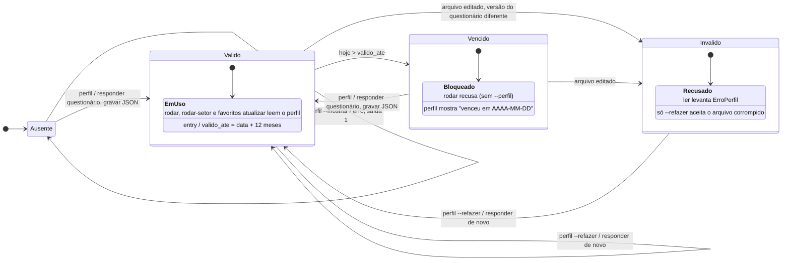
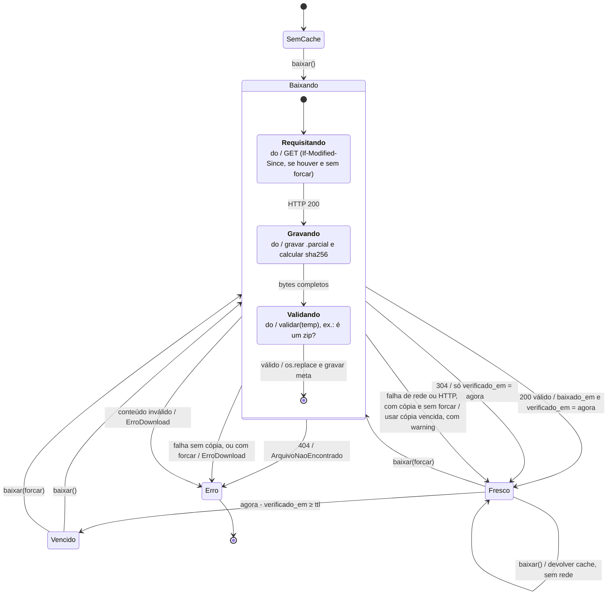
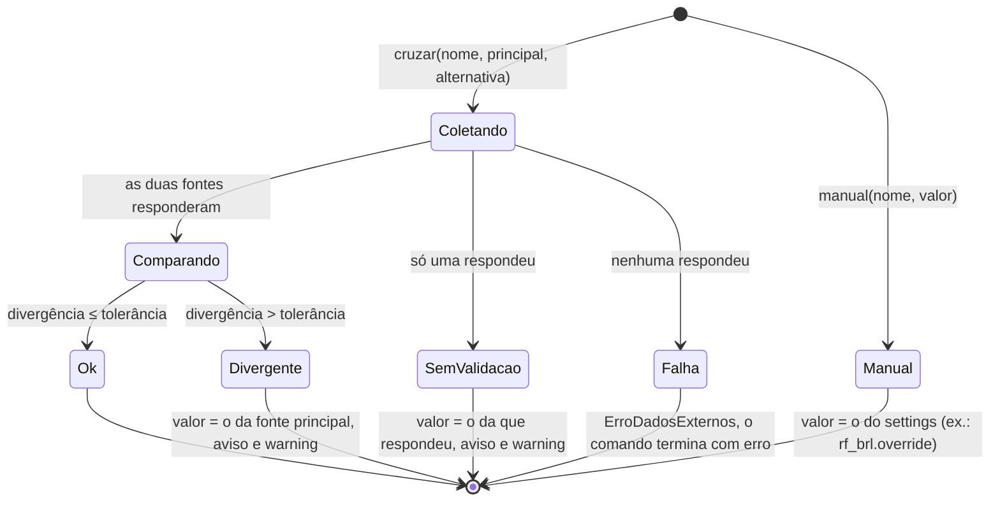
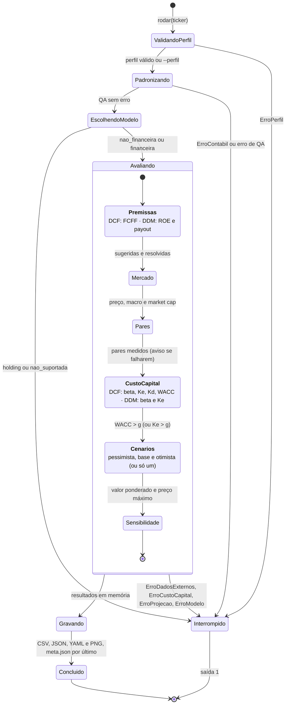
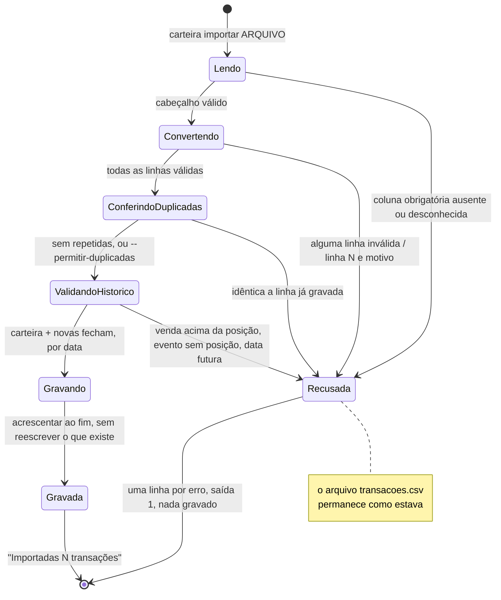
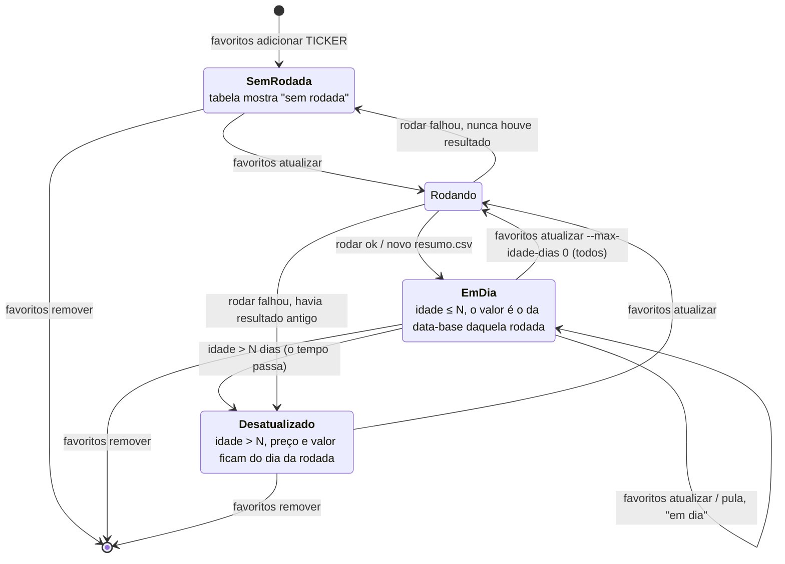

# Diagramas de Estados — Lastro

Mostram os estados pelos quais um objeto (ou uma execução) passa durante a vida, e os **eventos** que provocam cada transição. Só entram os elementos que têm ciclo de vida de fato; os cálculos puros (`dcf`, `ponte`…) não têm estado, e por isso não aparecem. Índice em [`diagramas.md`](diagramas.md).

> **Notação** (Aula 09). Transição: `evento [guarda] / ação`. `[*]` = estado inicial ou final. `entry/` e `exit/` = ações ao entrar e sair; `do/` = atividade em andamento. Estados compostos agrupam subestados; `<<choice>>` é uma decisão sobre a guarda.

| # | Objeto | Onde está no código |
|---|---|---|
| 1 | Perfil do investidor (`perfil_investidor.json`) | `perfil/registro.py` |
| 2 | Arquivo no cache de download | `data/http.py` (`baixar`) |
| 3 | Leitura validada entre duas fontes (`Validado`) | `data/validacao.py` (`cruzar`) |
| 4 | Execução do comando `rodar` | `cli.py` (`rodar`) |
| 5 | Importação de transações da carteira | `carteira/arquivo.py` (`acrescentar`) |
| 6 | Favorito e o seu último resultado | `saida/favoritos.py` |

## 1. Perfil do investidor (`perfil_investidor.json`)

O perfil tem **validade de 12 meses** e um esquema rígido: `registro.ler` recalcula a pontuação e recusa um arquivo adulterado. O perfil `--perfil X` (override) não passa por aqui: não lê nem grava o arquivo.

- **Ausente**: não há arquivo (`FileNotFoundError` em `ler`). `rodar` sem `--perfil` falha com a instrução de rodar `valuation perfil`.
- **Válido** inclui o dia de `valido_ate` (`vencido` é `hoje > valido_ate`). Um perfil gravado em 29/02 vale até 28/02 do ano seguinte.
- O **veto** (horizonte menor que 2 anos ou "não aceito perdas") é aplicado dentro da transição de gravação e força `conservador`; não é um estado.

## 2. Arquivo no cache de download (`http.baixar`)

Estados de um arquivo em `data/raw/`, com o seu `.meta.json`. É por esta máquina que o resto do projeto fica **offline dentro do TTL**.

- `Fresco` aqui inclui a "cópia vencida usada com aviso": o chamador recebe `do_cache=True`, mas o `verificado_em` **não** é renovado, então a próxima chamada tenta a rede de novo.
- `404` ignora a cópia: propaga sempre. `forcar` desliga o `If-Modified-Since` **e** o *fallback* para cópia.
- O `.parcial` é descartado se a validação falhar; o arquivo anterior nunca é sobrescrito por conteúdo inválido.

## 3. Leitura validada entre duas fontes (`Validado`)

Cada dado de mercado e macro (preço, dólar, Selic, IPCA, Rf) nasce de uma comparação entre fonte principal e alternativa (ADR 0004). O `status` final é o estado do objeto; **só** a ausência das duas fontes interrompe.

A divergência é relativa (`|a−b|/|a|`) em preço e câmbio (2% e 1,5%) e absoluta nas taxas (Selic, IPCA, Rf). Os avisos sobem para o terminal e para o `meta.json`.

## 4. Execução do comando `rodar`

Estados da execução de `valuation rodar TICKER` (acompanha o [diagrama de atividades](diagrama_atividades.md); aqui o interesse é **onde ela pode terminar**). Qualquer erro de domínio leva a `Interrompido`, com mensagem em PT-BR e saída 1.

- `Gravando` só começa depois do cálculo dos cenários e da sensibilidade: um erro de domínio no cálculo não deixa saída pela metade. O `meta.json` é gravado por último, e lista os arquivos que existem na pasta (inclusive os de execuções anteriores).
- `Concluido` com avisos continua sendo sucesso (saída 0): divergência de fontes, par sem dados, VT/EV alto, ROE abaixo do Ke e semelhantes são avisos, não erros.

## 5. Importação de transações da carteira

Estados de uma importação (`carteira importar`) ou de um lançamento (`carteira lancar`, que pula a leitura do arquivo). A saída é **tudo ou nada**.

## 6. Favorito e o seu último resultado

O "cache de resultados" é o `resumo.csv` da pasta mais recente de `saida/{TICKER}/` (ADR 0021). O estado é **derivado** (idade do resultado contra `--max-idade-dias`); não há campo persistido.

`favoritos` (sem subcomando) só **lê**: mostra o estado de cada ticker sem rede. O valor exibido é sempre o da última rodada, com o preço daquele dia (por isso existe a coluna *Idade*).
