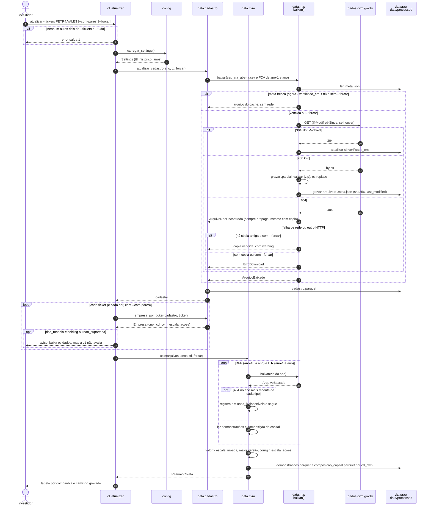
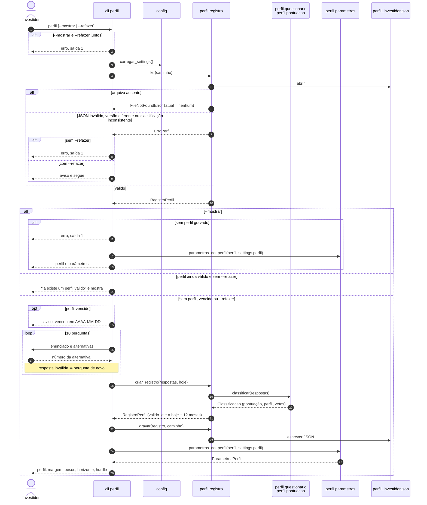
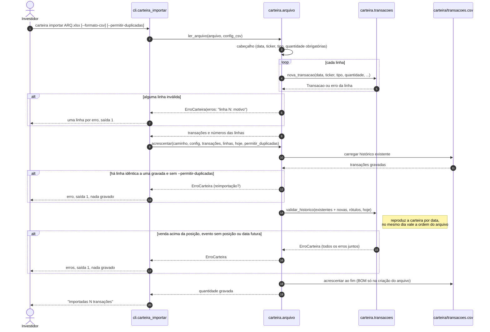
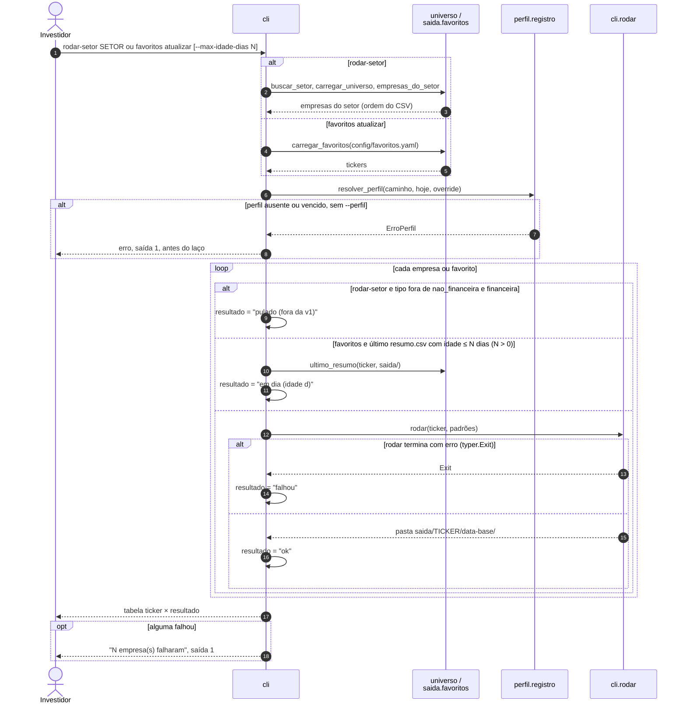
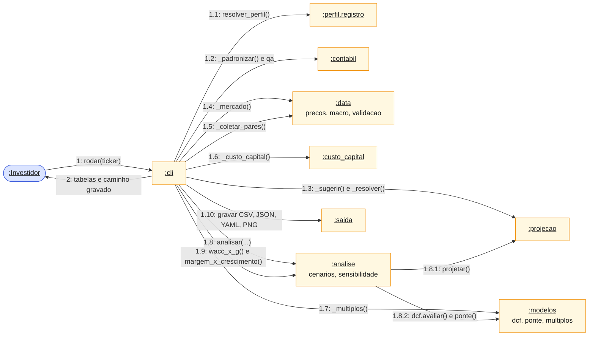
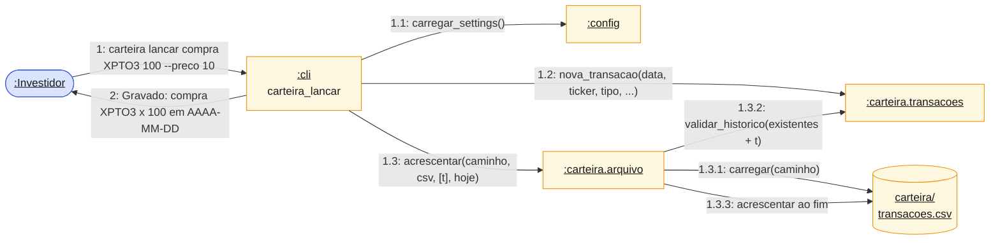

# Diagramas de Interação — Lastro

Mostram **mensagens trocadas entre objetos** para realizar um caso de uso: o de **sequência** enfatiza a ordem no tempo; o de **comunicação** (colaboração, na Aula 07) enfatiza quem fala com quem, com as mensagens numeradas. Índice em [`diagramas.md`](diagramas.md).

- `valuation rodar TICKER` (o fluxo principal) tem o seu próprio [diagrama de sequência](diagrama_sequencia.md). Aqui estão os **demais** fluxos e a visão de comunicação do `rodar`.
- Os participantes são módulos do código (as classes do [diagrama de classes](diagrama_classes.md) são dados; o comportamento é de funções de módulo).

> **Notação.** Sequência: seta cheia = chamada síncrona (o emissor espera), tracejada = retorno; `alt`/`opt`/`loop` = fragmentos combinados (condição, opcional, repetição); `autonumber` numera as mensagens. Comunicação: o Mermaid não tem esse diagrama, então é um `flowchart` com os objetos como nós e as mensagens como rótulos numerados (`1`, `1.1`, `1.2.1`…): o prefixo indica a *thread* de controle (quem chamou quem); a letra, quando há, indica fluxos concorrentes.

## 1. Sequência — `valuation atualizar`

Realiza o **UC02**. Mostra o ponto único de download (`http.baixar`) e as três saídas possíveis do cache.

Pontos de atenção:

- **404 nunca usa a cópia em cache** (`http.baixar` sempre o propaga) e só é tolerado por `cvm.coletar` no ano mais recente de cada tipo (o documento do ano corrente ainda pode não existir); em anos antigos vira erro.
- `--forcar` ignora o cache **e** desliga o *fallback* para cópia vencida: falha de rede vira erro.
- O download vai para `.parcial`, é validado (`validar_zip`) e só então substitui o arquivo, para nunca gravar uma página de erro HTML como se fosse zip.

## 2. Sequência — `valuation perfil`

Realiza o **UC01**. Ciclo de vida do perfil em [estados](diagrama_estados.md#1-perfil-do-investidor-perfil_investidorjson).

A validade é conferida contra `date.today()` (passado por `cli`), **não** contra a `data_base` da avaliação.

## 3. Sequência — `valuation carteira importar`

Realiza o **UC15** (o **UC14**, `lancar`, é o mesmo fluxo com uma só transação e sem a leitura de arquivo). A regra é *tudo ou nada*: nada é gravado se qualquer linha ou o histórico falhar.

## 4. Sequência — execução em lote: `rodar-setor` e `favoritos atualizar`

Realizam o **UC10** e o **UC11**. Ambos chamam o `rodar` de cada empresa; uma falha isolada não interrompe as demais, e o comando sai com 1 se alguma falhou.

O `rodar-setor` não gera resumo consolidado entre empresas (ADR 0019); cada empresa grava a sua pasta como em `rodar`. No `favoritos atualizar`, o "cache de resultados" é o próprio `resumo.csv` da pasta mais recente (ADR 0021): nada novo é persistido.

## 5. Comunicação — `valuation rodar TICKER` (visão condensada)

Os mesmos objetos do [diagrama de sequência](diagrama_sequencia.md), vistos pelas **ligações** entre eles. O número indica a ordem; `1.8.1` é uma mensagem enviada **durante** a `1.8`.

A estrutura em **estrela** em torno de `cli` é intencional (regra do projeto): `cli.py` só orquestra; as camadas não se chamam entre si, e o motor de cálculo recebe tudo por parâmetro. A única colaboração direta entre camadas é `analise → projecao` e `analise → modelos`, dentro do laço de cenários, que dependem só de funções puras.

## 6. Comunicação — `valuation carteira lancar`

Realiza o **UC14**.

Em erro (`ErroCarteira`), a mensagem `2` vira uma linha por erro e a saída é 1; o arquivo permanece como estava.
