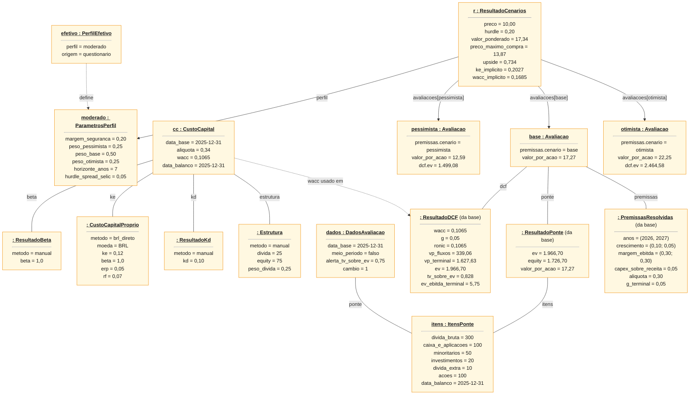
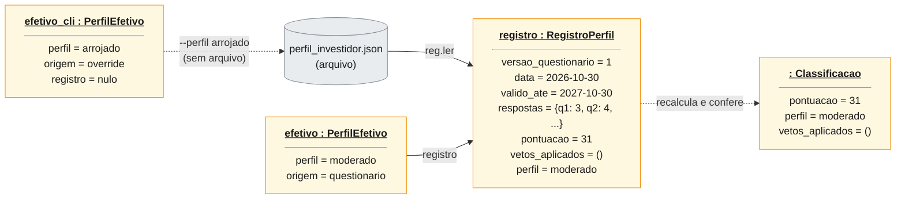
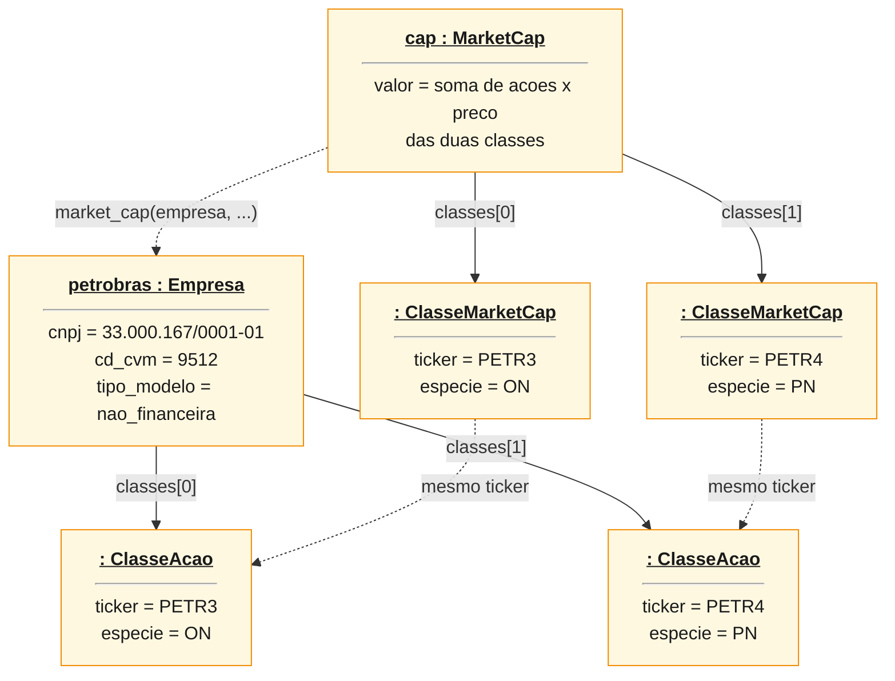
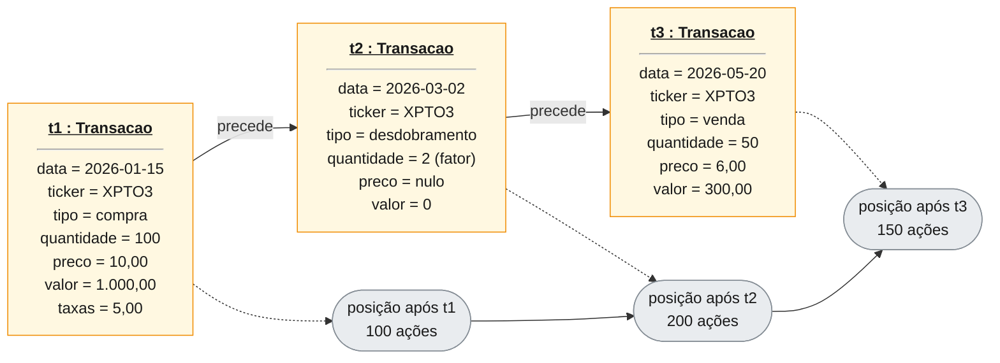

# Diagrama de Objetos — Lastro

"Fotografias" do sistema em execução: instâncias das classes do [diagrama de classes](diagrama_classes.md), com valores de atributos e as ligações entre elas. São estáticos; a evolução no tempo está nos diagramas de [sequência](diagrama_sequencia.md), [interação](diagrama_interacao.md) e [estados](diagrama_estados.md). Índice em [`diagramas.md`](diagramas.md).

> **De onde vêm os números.** Nenhum valor de mercado ou contábil aqui é dado real de empresa. O cenário da seção 1 é o **sintético dos testes** (`tests/test_dcf.py`, `tests/test_cenarios.py`), de uma companhia fictícia `XPTO3`; os valores foram obtidos **instanciando os objetos com o próprio código** (`dcf.avaliar` e `cenarios.analisar`), não digitados à mão. Os da seção 2 vêm do esquema do JSON do perfil no `CLAUDE.md` (seção 8.3), e os da seção 3 são só cadastro (CNPJ, `CD_CVM` e espécies, registrados em `docs/fontes.md`). Os da seção 4 são ilustrativos.

> **Notação.** O Mermaid não tem diagrama de objetos; é desenhado como `flowchart`. Cada caixa é uma instância, com o nome sublinhado no formato `nome : Classe`, os valores dos atributos e as ligações (*links*) rotuladas com o papel. Objetos anônimos aparecem como `: Classe`. Quando a classe tem coleção, os elementos aparecem individualmente (o Mermaid não desenha *MultiObjects* empilhados).

## 1. Resultado de `valuation rodar XPTO3` (DCF, perfil moderado)

Estado ao fim de `cenarios.analisar`, com a data-base em 31/12/2025, preço de mercado R$ 10,00 e Selic de 15%: o `CustoCapital`, os dados da avaliação, os três cenários e o resultado ponderado.

Conferência dos números (cálculo à mão, igual aos testes):

- `wacc` = Ke × E/(D+E) + Kd × (1 − t) × D/(D+E) = 0,12 × 0,75 + 0,10 × 0,66 × 0,25 = **0,1065**.
- `equity` (base) = EV 1.966,70 − dívida 300 + caixa 100 − minoritários 50 + investimentos 20 − `divida_extra` 10 = **1.726,70**; por ação (100 ações) = **17,27**.
- `valor_ponderado` = 0,25 × 12,59 + 0,50 × 17,27 + 0,25 × 22,25 = **17,34**; `preco_maximo_compra` = 17,34 × (1 − 0,20) = **13,87**; `hurdle` = Selic 0,15 + 0,05 = **0,20**.
- As caixas `: ResultadoDCF`, `: ResultadoPonte` e `: PremissasResolvidas` são anônimas e pertencem à `base`; as dos outros dois cenários têm a mesma forma e foram omitidas.
- Relações do diagrama de classes que aparecem como *links*: `ResultadoCenarios *-- Avaliada` (aqui, três `Avaliacao`), `Avaliacao *-- ResultadoDCF | ResultadoPonte | PremissasResolvidas`, `CustoCapital *-- ...` e a **ponte compartilhada** (`itens` é o mesmo objeto nos dados e no resultado da ponte).

## 2. Perfil gravado em disco

O JSON de `perfil/perfil_investidor.json` e os objetos que `reg.ler` reconstrói. O `RegistroPerfil` guarda o **número da alternativa** escolhida; a pontuação e o perfil são recalculados na leitura e, se não baterem com o arquivo, o arquivo é recusado.

31 pontos cai na faixa 25 a 37 (moderado) e não há veto. `valido_ate` = `data` + 12 meses. O segundo `PerfilEfetivo` mostra o caso em que o investidor passa `--perfil arrojado`: o arquivo nem é lido, o `registro` é nulo e a origem é `override` (registrada no `meta.json`).

## 3. Cadastro de uma empresa com duas classes de ação

Exemplo do que a aula chama de *MultiObjects*: uma `Empresa` com vários `ClasseAcao`. Só dados de cadastro (nenhum valor financeiro).

`empresa_por_ticker` agrupa por CNPJ: pedir `PETR3` ou `PETR4` devolve a mesma empresa. O valor por ação do `rodar` vale para todas as classes (aproximação documentada no `CLAUDE.md`, seção 11.2). Este cadastro vem do FCA da CVM, ajustado por `config/cadastro_manual.csv`.

## 4. Carteira: histórico de transações

Três transações sucessivas de `XPTO3` (valores ilustrativos), como `carteira/transacoes.csv` as guarda. A quantidade em carteira **não é um objeto persistido**: `validar_historico` a reproduz por data, e é por ela que uma venda acima da posição é recusada.

Se `t3` pedisse 250 ações, a posição de 200 não bastaria e `acrescentar` recusaria tudo, sem gravar nada, citando a linha. O desdobramento 2:1 dobra a posição; `valor` e `taxas` não se aplicam a eventos.
