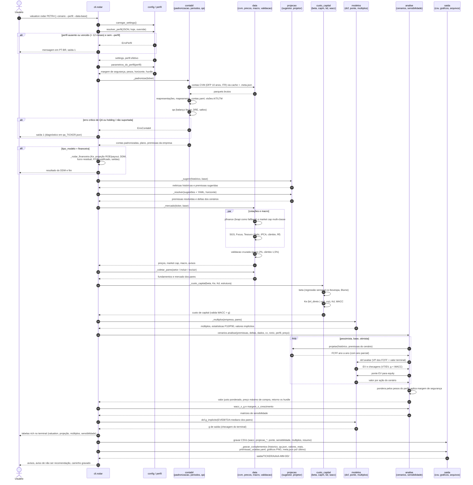

# Diagrama de Sequência — `valuation rodar TICKER`

Complementa o [diagrama de atividades](diagrama_atividades.md): aqui o foco é **quem chama quem, e em que ordem**, no caminho não financeiro (DCF) do comando `rodar` em [`cli.py`](../src/valuation/cli.py). O ramo financeiro (DDM) está resumido no bloco `alt`. Contratos e parâmetros ficam no [`guia.md`](../guia.md).

## Notas

- Qualquer `Erro*` de domínio (`ErroPerfil`, `ErroContabil`, `ErroCustoCapital`, `ErroModelo` etc.) é capturado em `rodar` e vira mensagem em PT-BR com saída não nula (`_erro`).
- O motor de cálculo (`projetar`, `dcf`, `ponte`, `cenarios`, `sensibilidade`) é puro: não faz I/O nem lê relógio. Todo I/O fica em `data/` e `saida/`; `cli.py` só orquestra.
- `--cenario base|pessimista|otimista` roda um só cenário no laço; `--sem-graficos` omite os PNG; `--forcar` ignora o cache em `_mercado`.
- Fora deste fluxo: `valuation atualizar` (só ingestão), `perfil` (questionário) e `carteira` (ADR 0020).
